# Wachalarm IP-Web

**`Wachalarm IP-Web`** ist eine Webanwendung, die auf jedem Endgerät - egal ob Windows, Linux, Mac oder Smartphone - Alarminformationen anzeigen kann, ohne dass zusätzliche Software installiert werden muss.

Es wird ein moderner Webbrowser (z.B. [Firefox](https://www.firefox.com/de/) oder [Chrome](https://www.google.com/intl/de/chrome/safety/)) zur Darstellung benötigt. Zusätzlich kann mit einem Login und entsprechenden Berechtigungen die Anzeige weiterer Detailinformationen freigeschaltet werden. Die Anwendung ist Open-Source und kann - unter Berücksichtigung der [Lizenz](https://github.com/Robert-112/n112_waip-web/blob/master/LICENSE.md) - von jedem kostenfrei genutzt und weiterentwickelt werden.

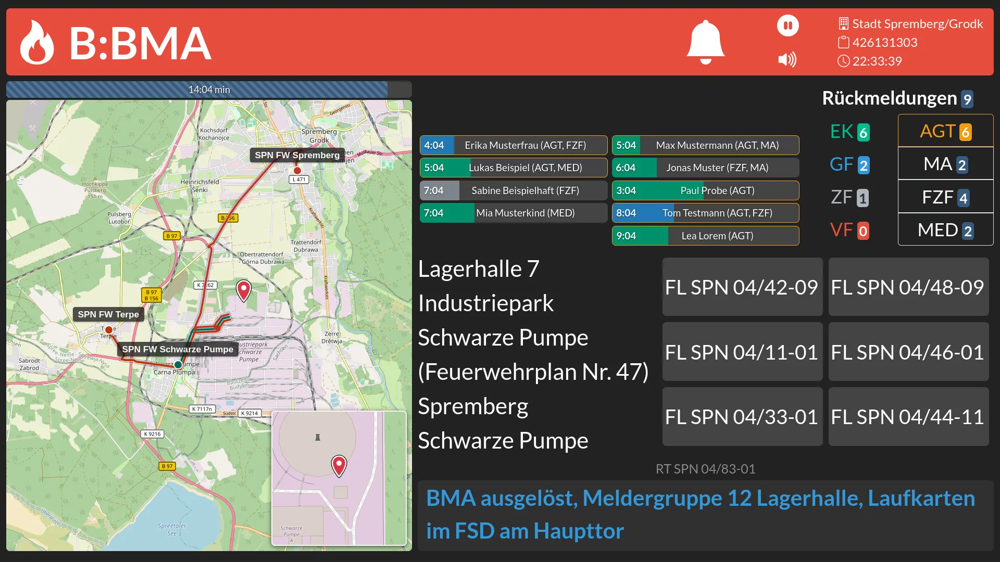

*Abbildung: Alarmmonitor der Stadt Spremberg, mit Login (Version 2.2, fiktiver Einsatz)*

Bereits ohne Anmeldung bietet **`Wachalarm IP-Web`** einen großen [Funktionsumfang](#funktionsumfang), jedoch werden dabei nur grundlegende Einsatzinformationen angezeigt, um den Anforderungen des Datenschutzes gerecht zu werden. Zu diesen Informationen zählen:

- *Einsatzart und Einsatzstichwort*
- *Fahrt mit oder ohne Sondersignal*
- *Ort und Ortsteil des Einsatzes*
- *Karte mit grobem Einsatzort* (Umkreis)
- *Anfahrtswege der alarmierten Wachen* (sofern ein Routing-Server angebunden ist)
- *alarmierte Einsatzmittel*
    - Einsatzmittel der eigenen Wache
    - weitere alarmierte Einsatzmittel
- *Rückmeldungen der Einsatzkräfte per App*
    - Rolle und Funktion der Einsatzkraft
    - ungefähre Ankunftszeit am Gerätehaus

Mit einer Anmeldung können weitere Einsatzdaten eingesehen werden, sofern die hinterlegte Berechtigung es zulässt. Zu den erweiterten Einsatzinformationen gehören:

- genaue Ortsangaben wie Objekt &amp; Teilobjekt, Straße &amp; Hausnummer, Feuerwehrplan uvm.
- exakte Koordinate des Einsatzortes inkl. Detailkarte
- Bemerkungen der Leitstelle zur Ersteinschätzung des Einsatzgrundes
- Namen der Einsatzkräfte, welche per App-Rückmeldung dem Einsatz zugesagt haben
- Einsatznummer des Einsatzes

Mit jedem neuen Einsatz wird ein Alarmton inkl. synthetischer Sprachansage abgespielt. Nach einer einstellbaren Zeit gehen Alarmmonitore automatisch in den Standby und zeigen dann einen Bildschirmschoner mit Datum &amp; Uhrzeit an, auf Wunsch auch mit Wetter, amtlichen Unwetterwarnungen und Terminen. Nach einer festgelegten Ablaufzeit (je nach Konfiguration z.B. 30 Minuten) werden alle Einsatzdaten aus dem System entfernt und sind nicht mehr abrufbar. Lediglich Brand- und Hilfeleistungseinsätze bleiben mit groben Angaben für einige Tage in einem Kurz-Archiv sichtbar. Die vollständigen Einsatzdaten finden sich jedoch weiterhin in anderen Systemen wie z.B. dem Einsatzleitsystem der Leitstelle.

> Alle Abbildungen in dieser Beschreibung zeigen **fiktive Einsätze**. Namen von Einsatzkräften, Benutzerkonten, IP-Adressen und ähnliche Angaben wurden verfremdet.

---

# Funktionsumfang

Die nachfolgend aufgeführten Funktionen stehen im **`Wachalarm IP-Web`** generell allen Nutzern zur Verfügung, benötigen zum Freischalten jedoch meist einen Login mittels Benutzernamen und Passwort, bzw. mittels Geräteanmeldung.

---

## Alarmmonitor

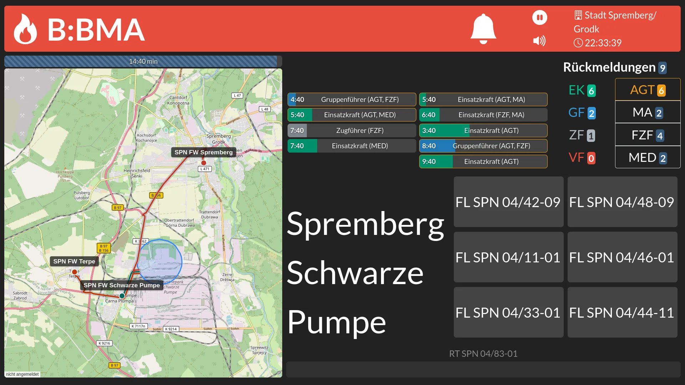

*Abbildung: Alarmmonitor der Stadt Spremberg, mit Rückmeldungen, ohne Login*

- Individueller Alarmmonitor für eine oder mehrere Wachen
- Darstellung von Einsatzart, Stichwort, Sondersignal, Ortsdaten (Objekt, Teilobjekt, Ort, Ortsteil, Straße, Hausnummer) inkl. Karte mit Markierung des Einsatzortes
- Anzeige der Anfahrtswege von den alarmierten Wachen zum Einsatzort (optional, über einen eigenen [OSRM](https://project-osrm.org/)-Server)
- mit Login zusätzlich eine kleine Detailkarte des Einsatzortes
- Anzeige der alarmierten eigenen Einsatzmittel und weiterer beteiligter fremder Einsatzmittel
- Beschreibung des Einsatzes
- Zusatzinformationen wie Einsatznummer, Einsatzzeit, Wachenname, Ablaufzeit, Feuerwehrplan uvm.
- neue Einsätze werden durch einen Gong und eine Sprachansage automatisch in deutscher Sprache angekündigt (Text-To-Speech, wahlweise mit [Piper](https://github.com/rhasspy/piper))
- App-Rückmeldungen (Brandenburg-Alarm) von Einsatzkräften werden passend zur aufgerufenen Wache angezeigt (aber nur wenn positive Rückmeldungen zur Einsatzteilnahme gesendet wurden) und akustisch signalisiert
- wird kein Einsatz dargestellt, wird ein Bildschirmschoner angezeigt (siehe [Standby-Anzeige](#standby-anzeige))
- angemeldete Benutzer können die Anzeigezeit für Alarme (1 bis 60 Minuten) und die Breite der Karte (20 bis 60 %) einstellen, für alle anderen gilt eine standardmäßig festgelegte Anzeigezeit (z.B. 15 Minuten)
- die Darstellung passt sich automatisch an das Endgerät an (Fernseher im Querformat, Tablet, Smartphone im Hochformat) und läuft auch auf leistungsschwacher Hardware wie einem Raspberry Pi
- es können für beliebig viele Wachen entsprechende Alarmmonitore hinterlegt und angezeigt werden, dabei wird in 5 Arten unterschieden (`n` steht für eine Zahl der Wachennummer):
    1. `/waip/0`
        - öffnet den globalen Alarmmonitor, der alle im System eingehenden Alarme anzeigt
    2. `/waip/n` (`1` bis `5`)
        - öffnet den Alarmmonitor für einen gesamten Leitstellenbereich
        - die Nummer entspricht der internen Nummerierung der Leitstelle
    3. `/waip/nn` (`01` bis `99`)
        - öffnet den Alarmmonitor eines Landkreises
        - es werden die Alarme aller hinterlegten Wachen des Landkreises angezeigt
        - die Nummer entspricht der Kennung des Landkreises entsprechend des amtlichen Gemeindeschlüssels
    4. `/waip/nnnn` (`0001` bis `9999`)
        - öffnet den Alarmmonitor eines Aufgabenträgers
        - z.B. einer amtsfreien Gemeinde, einer Stadt, eines Amtes, oder auch des Rettungsdienstes eines Landkreises
        - die Nummer entspricht dabei den ersten 4 Zahlen der Wachennummer
    5. `/waip/nnnnnn` (`000001` bis `999999`)
        - öffnet den Alarmmonitor einer einzigen Wache
        - es werden nur Einsätze dieser Wache angezeigt
        - die Nummer entspricht der Wachennummer
- Außerdem können beim Aufruf eines Alarmmonitors weitere optionale Parameter übergeben werden, um das Anzeigeverhalten zu steuern
    - `rmld=off`
        - blendet App-Rückmeldungen im Alarmmonitor aus
        - z.B. bei Rettungswachen, die keine Rückmeldungen verwenden
    - `sound=off`
        - deaktiviert Hinweise zur Audioausgabe
        - z.B. wenn kein Lautsprecher angeschlossen ist
    - `anim=off`
        - reduziert Animationen
        - z.B. für leistungsschwache Geräte wie einen Raspberry Pi 3
    - `wetter=on` bzw. `wetter=off`
        - blendet Wetter und Unwetterwarnungen im Standby ein bzw. aus, auch ohne Anmeldung
    - Beispielaufruf: `https://wachalarm.inter.net/waip/661214?rmld=off&sound=off`
- die Parameter lassen sich auch bequem auf der Auswahlseite des Alarmmonitors per Schalter setzen

---

## Standby-Anzeige

*Abbildung: Standby-Anzeige mit Wetter und Terminen*

- ist kein Einsatz aktiv, zeigt der Alarmmonitor Uhrzeit und Datum an
- auf Wunsch werden zusätzlich angezeigt:
    - das aktuelle Wetter sowie die Vorhersage für morgen und übermorgen
    - amtliche Unwetterwarnungen des Deutschen Wetterdienstes
    - die Waldbrandgefahrenstufe (ab einer einstellbaren Stufe)
    - die nächsten Termine aus einem öffentlichen Kalender (iCal/ICS), z.B. Dienstabende
- alle Daten holt ausschließlich der Server, die Alarmmonitore selbst benötigen keinen Zugriff auf das Internet
- die Wetterdaten stammen vom Deutschen Wetterdienst und werden über einen selbst betriebenen [Bright Sky](https://brightsky.dev/)-Dienst abgerufen
- angemeldete Benutzer schalten Wetter und Kalender unter `Einstellungen` ein, für Monitore ohne Anmeldung gibt es den Parameter `wetter=on`
- der gesamte Inhalt wandert regelmäßig ein Stück über den Bildschirm, damit sich nichts in das Display einbrennt

---

## Dashboard

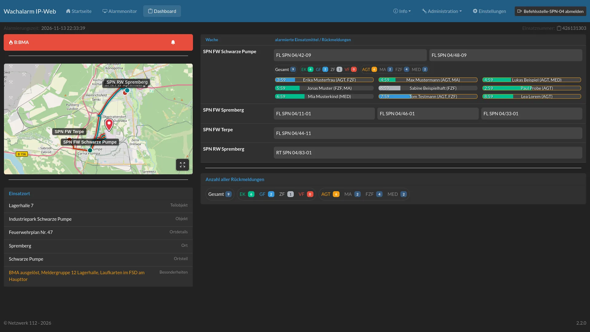

*Abbildung: Dashboard für einen Einsatz der Stadt Spremberg, mit Login*

- das Dashboard zeigt eine Gesamtübersicht für einen einzigen Einsatz
- es zeigt, ebenso wie der Alarmmonitor, alle einsatzrelevanten Informationen an und berücksichtigt dabei die Berechtigungen des Nutzers (sofern angemeldet)
- im Dashboard werden alle beteiligten Wachen inkl. der alarmierten Einsatzmittel und deren Anfahrtswege angezeigt
- es werden alle positiven Rückmeldungen zum Einsatz angezeigt, dabei erfolgt eine Zuordnung der Rückmeldungen zu den alarmierten Wachen
- die Rückmeldungen werden je Wache gezählt, inkl. einer Gesamt-Übersicht
- das Dashboard des Einsatzes aktualisiert sich von selbst, ohne dass die Seite neu geladen werden muss

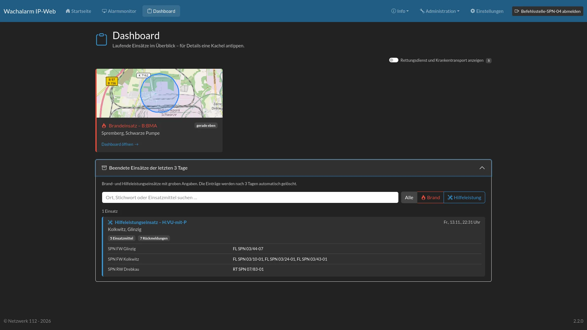

*Abbildung: Übersicht der laufenden Einsätze mit Kurz-Archiv*

- die Übersicht zeigt alle laufenden Einsätze als Kacheln mit kleiner Karte
- Rettungseinsätze und Krankentransporte sind standardmäßig ausgeblendet und lassen sich per Schalter einblenden
- beendete Brand- und Hilfeleistungseinsätze bleiben für einige Tage (Standard: 3 Tage) im Kurz-Archiv sichtbar
    - dort stehen nur grobe Angaben: Zeit, Ort und Ortsteil, Einsatzart und Stichwort, alarmierte Einsatzmittel sowie die Anzahl der Rückmeldungen
    - keine Karte, keine Straße, keine Einsatznummer und keine Namen
    - das Archiv kann durchsucht und nach Einsatzart gefiltert werden
- wird ein alter Link auf ein Dashboard aufgerufen, dessen Einsatz bereits beendet ist, erfolgt eine Weiterleitung zum passenden Eintrag im Archiv

---

## Rückmeldungen

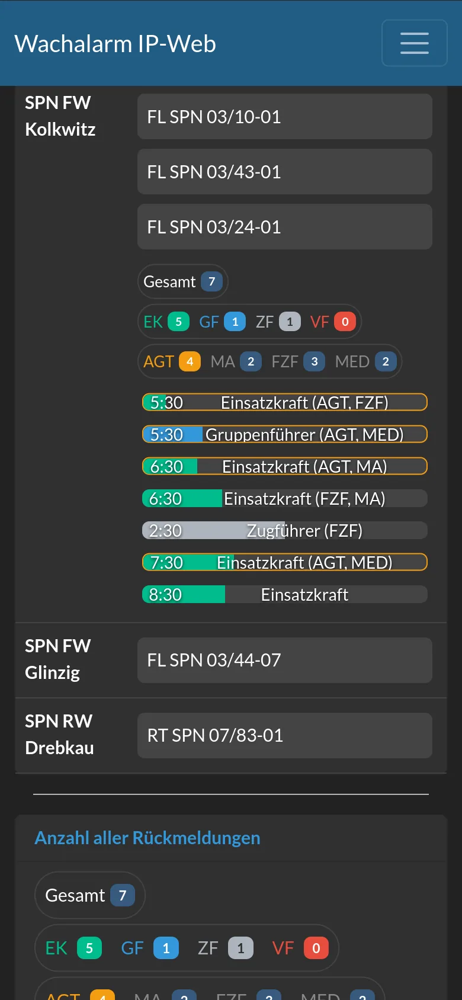

*Abbildung: öffentliche Darstellung der Rückmeldungen auf dem Smartphone (wenn freigeschaltet)*

- die Darstellung der Rückmeldungen bietet Einsatz- und Führungskräften eine einfache Möglichkeit, um einzuschätzen wie viele Personen am Einsatz teilnehmen werden und über welche Fähigkeiten diese verfügen
- **`Wachalarm IP-Web`** verarbeitet automatisch alle App-Rückmeldungen, die über die Schnittstelle (Rest-Api) eingehen
- die Anzeige erfolgt im Alarmmonitor und im Dashboard
- die Rückmeldungen werden den alarmierten Wachen zugeordnet und sofort nach Eingang angezeigt
- Bedeutung der verwendeten Abkürzungen:
    - Rollen:
        - `EK` - Einsatzkraft
        - `GF` - Gruppenführer
        - `ZF` - Zugführer
        - `VF` - Verbandsführer
    - Funktionen:
        - `AGT` - Atemschutzgeräteträger
        - `MA` - Maschinist
        - `FZF` - Fahrzeugführer
        - `MED` - medizinische Kenntnisse
- Rückmeldungen werden anhand ihrer Rollen und Funktionen aufsummiert, so dass schnell eine Gesamtanzahl ersichtlich ist
- jeder Balken zeigt die verbleibende Zeit bis zur ungefähren Ankunft am Gerätehaus, ist diese erreicht erscheint ein Haken
- Rückmeldungen mit Atemschutz (`AGT`) sind farblich umrandet
- mit Login und entsprechender Berechtigung wird auch der Name der Einsatzkraft in der Rückmeldung angezeigt, ohne Login erscheint stattdessen die Rolle

---

## Smartphone und Tablet

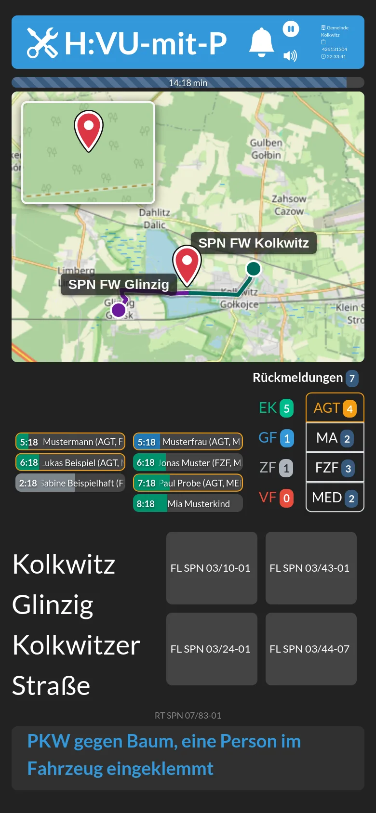

*Abbildung: Alarmmonitor der Gemeinde Kolkwitz auf dem Smartphone, mit Login*

- Alarmmonitor und Dashboard sind auch auf Smartphones und Tablets nutzbar, im Hoch- und im Querformat
- auf kleinen Bildschirmen werden Karte, Rückmeldungen und Einsatzmittel untereinander angeordnet
- zu lange Namen in den Rückmeldungen laufen als Ticker durch den Balken

---

## Administration

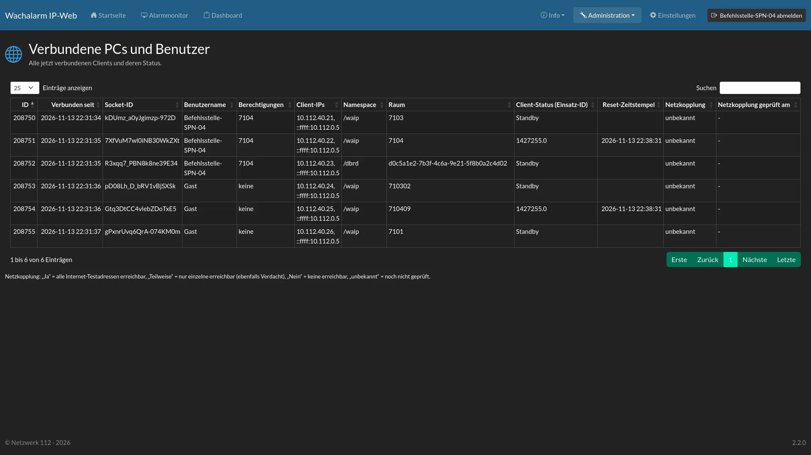

*Abbildung: Übersicht der verbundenen Alarmmonitore und Dashboards*

- als Benutzer mit der Berechtigung "Administrator" können zentrale Einstellungen des **`Wachalarm IP-Web`** verwaltet werden, dazu gehören:
    - anlegen, bearbeiten und löschen von Benutzern inkl. Kennwortvergabe und Zuweisung der Berechtigungen
    - Bearbeiten der Stammdaten der hinterlegten Wachen sowie das Anlegen von neuen Wachen
    - Einsicht in die derzeit aufgerufenen Alarmmonitore und Dashboards inkl. von Informationen zu den verbundenen [Websockets](https://socket.io)
    - Prüfung, ob ein Alarmmonitor unzulässig mit dem Internet verbunden ist (Netzkopplung)
    - Anzeige der aktuell hinterlegten Einsätze
    - Anzeige einiger Log-Einträge
    - Pflege der Wetter-Standorte für die Standby-Anzeige
    - Pflege von Ersetzungen für die Sprachansage, inkl. Probehören der Aussprache

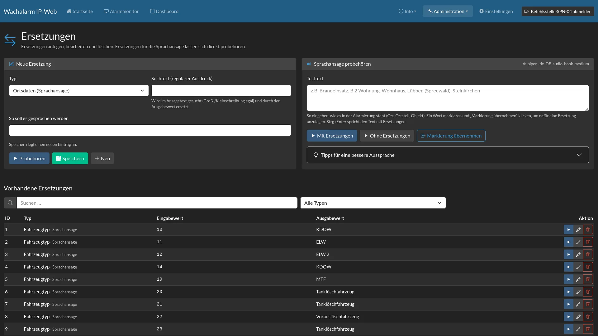

*Abbildung: Ersetzungen für die Sprachansage mit Probehören*

- für die Überwachung steht unter `/check_mk` ein Local Check für [Checkmk](https://checkmk.com/) bereit (nur von `localhost` erreichbar)
- sicherheits- und stabilitätsrelevante Ereignisse können zusätzlich als JSON-Log (ECS) z.B. an Elasticsearch übergeben werden, siehe [elastic/README.md](elastic/README.md)

---

# Installation

- benötigt wird [Node.js](https://nodejs.org/) ab Version 24.5
- Repository herunterladen und Abhängigkeiten installieren:
    - `git clone https://github.com/Robert-112/n112_waip-web.git`
    - `cd n112_waip-web`
    - `npm install`
- Datei `.env.example` nach `.env` kopieren und anpassen, mindestens:
    - `DEFAULT_PASS` und `DEFAULT_API_PASS` (Kennwörter für den ersten Start)
    - `SESSION_SECRET` und `JWT_SECRET` (lange, zufällige Zeichenketten)
    - `PUBLIC_URL`, `APP_NAME` und `COMPANY`
- Anwendung starten mit `npm start` (für den Dauerbetrieb z.B. mit [pm2](https://pm2.keymetrics.io/))
- die Anwendung ist anschließend unter `http://<server>:3001` erreichbar, die Datenbank wird beim ersten Start angelegt
- die Wachen werden per SQL importiert, die Datei `sql_seed.sql` enthält alle bekannten Wachen des Landes Brandenburg und einige Ersetzungen für die Sprachansage (z.B. `sqlite3 database.sqlite3 < sql_seed.sql`)
- optionale Dienste, die jeweils in der `.env` eingetragen werden:
    - [OSRM](https://project-osrm.org/) für die Anfahrtswege
    - [Piper](https://github.com/rhasspy/piper) (Wyoming-Protokoll) für eine natürlichere Sprachansage
    - [Bright Sky](https://brightsky.dev/) für Wetter und Unwetterwarnungen
    - Filebeat und Elasticsearch für die Auswertung der Logs

> ⚠ **Achtung:** Ohne Anpassung der `.env` gelten unsichere Standard-Kennwörter. Diese unbedingt vor dem ersten Start ändern!

---

# Weitere Ansichten

## Startseite

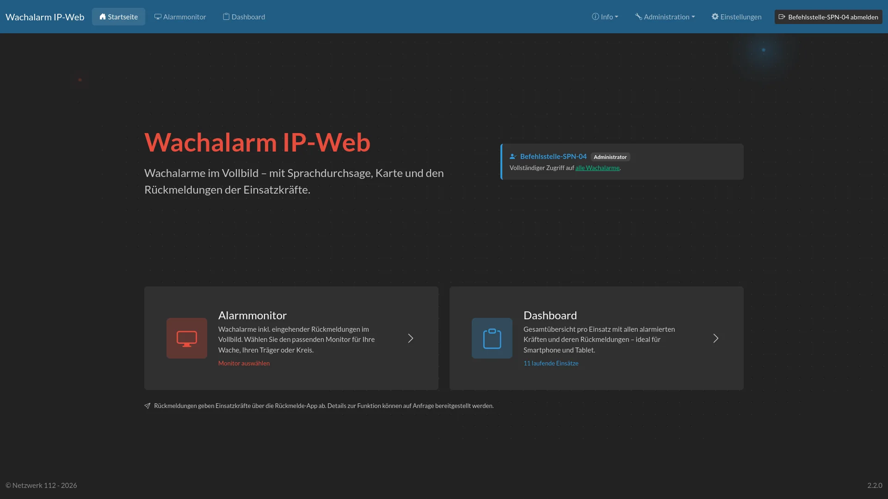

## Auswahl des Alarmmonitors

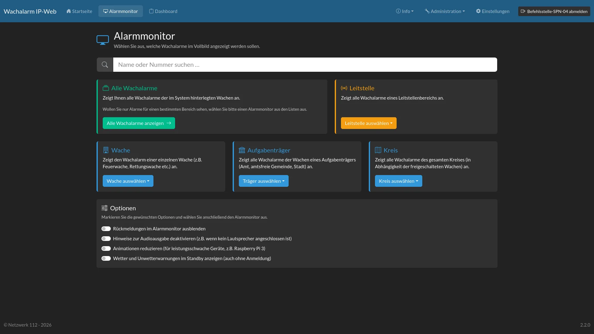

## Login

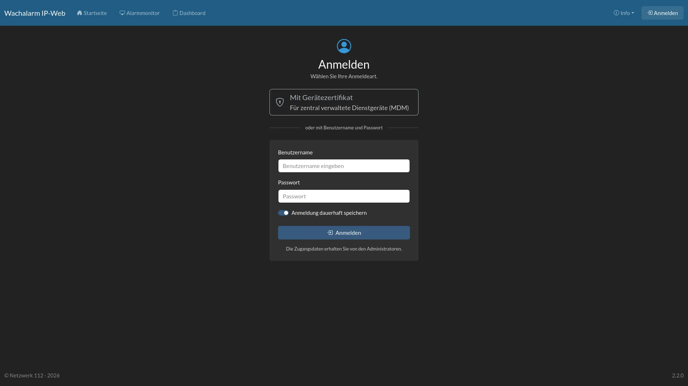

## Einstellungen

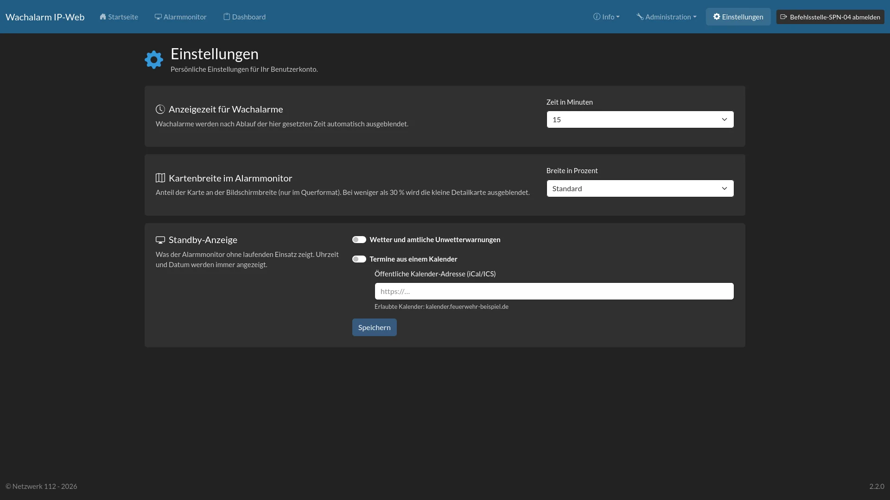

## Benutzerverwaltung

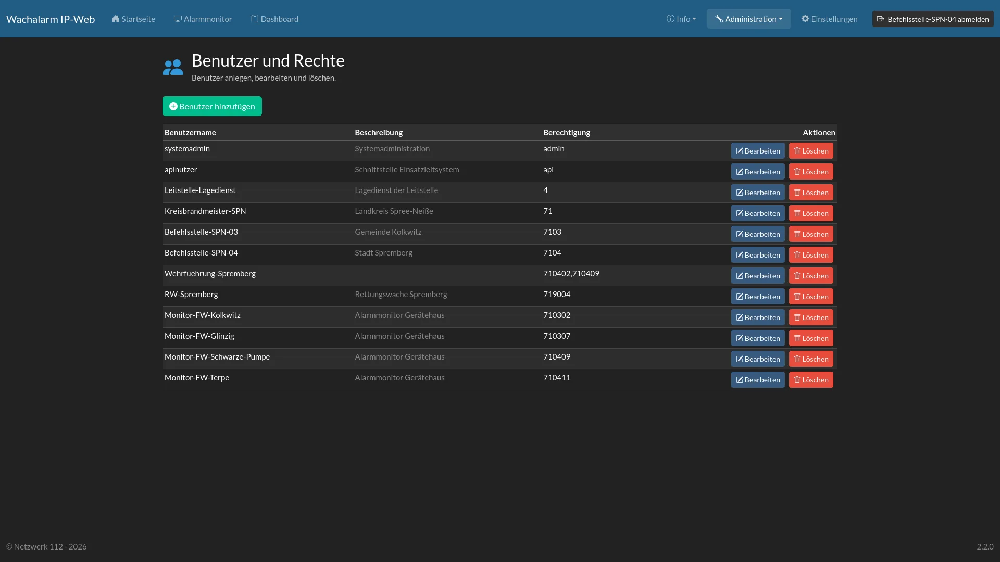

# Lizenz
#### [\[Creative Commons Attribution Share Alike 4.0 International\]](https://github.com/Robert-112/n112_waip-web/blob/master/LICENSE.md)
